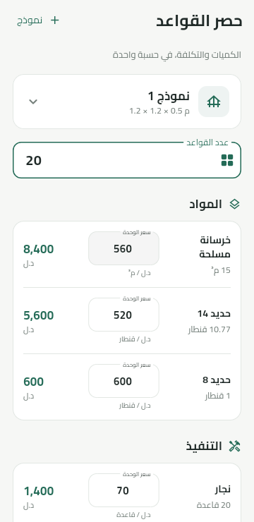
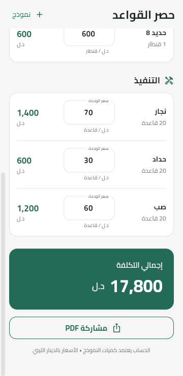

# Hasr Alqawaed · حصر القواعد

[](https://github.com/AlmotasmBazama/hasr-alqawaed/actions/workflows/flutter.yml)

An Arabic, right-to-left Flutter application for estimating foundation material quantities and construction costs. Built for Android and the web, with local persistence and an Arabic PDF report.

**[Try the live app](https://hasr-alqawaed-preview.web.app)** · **[العربية](README.ar.md)** · **[Sample PDF](docs/sample-report.pdf)** · **[Android downloads](https://github.com/AlmotasmBazama/hasr-alqawaed/releases)**

<table>
<tr><td></td><td></td></tr>
</table>

## Features

- Immediate quantity and cost calculation for concrete, two steel diameters, and three labor items.
- A protected built-in model and editable custom models with independent, persistent identifiers.
- Arabic and Persian digits, Arabic decimal separators, and stable input focus while editing.
- Versioned local JSON storage with serialized writes, corruption recovery and protection against overwriting unread data.
- One calculation result shared by the screen and a text-based A4 Arabic PDF with embedded Cairo fonts.
- Native Android sharing; browser file sharing when supported, with a PDF download fallback.
- Responsive layouts for narrow screens and larger text; no account or backend database required.

## Calculation example

For 20 foundations and the initial prices:

| Item | Quantity | Cost (LYD) |
| --- | --- | ---: |
| Concrete | 15 m³ | 8,400 |
| 14 mm steel | 70 / 6.5 quintals | 5,600 |
| 8 mm steel | 1 quintal | 600 |
| Carpenter | 20 foundations | 1,400 |
| Steel worker | 20 foundations | 600 |
| Casting | 20 foundations | 1,200 |
| **Total** | | **17,800** |

Concrete uses the model's **0.75 m³ per foundation**. Dimensions are descriptive; their product does not replace this quantity. Steel cost uses the full-precision converted quantity, not the displayed 10.77. Rounding happens only when formatting results.

## Architecture

| Directory | Responsibility |
| --- | --- |
| `lib/domain/` | Immutable data, Arabic number parsing and the calculation engine |
| `lib/data/` | SharedPreferencesAsync repository and ordered persistence |
| `lib/services/` | Shared PDF generation and conditional browser export |
| `lib/ui/` | Calculator, model editor, export dialog and theme |
| `test/` | Calculation, storage, input and UI regression tests |
| `integration_test/` | Android model lifecycle and native persistence test |

State management uses StatefulWidget. The app stores models, the selected model, count and prices locally. Web storage belongs to each browser origin; data is not synchronized between devices.

## Run and build

Validated with **Flutter 3.41.9 / Dart 3.11.5**. Android minimum SDK: 24.

```sh
git clone https://github.com/AlmotasmBazama/hasr-alqawaed.git
cd hasr-alqawaed
flutter pub get
flutter run
```

```sh
flutter analyze
flutter test
flutter build web --release --no-web-resources-cdn
flutter build apk --debug
```

The APK is generated at `build/app/outputs/flutter-apk/app-debug.apk`. To test Android integration, run `flutter test integration_test/app_test.dart -d <device-id>`, then rebuild the normal APK before distributing it. Use a checkout path with ASCII characters on Windows if Android tools reject a non-ASCII path.

The shared code includes an iOS project, but iOS builds have not been verified; they require macOS and Xcode.

## Validation

- 27 focused Flutter tests covering exact totals, custom coefficients, invalid input, persistence ordering, failed saves, lifecycle races and PDF export behavior.
- An Android integration test plus emulator checks for the numeric keyboard, persistence across process restart, enlarged text and offline PDF sharing.
- Local and deployed web checks at 1280×900 and 360×740: input, model creation/editing, reload persistence, actual PDF downloads and absence of JavaScript or asset-loading errors.
- Downloaded reports inspected for one-page A4 layout, connected Arabic, embedded fonts and matching amounts.

Physical-phone browser sharing has not been verified. GitHub Actions runs analysis, tests and a web release build on pushes and pull requests.

## Web hosting

The live demo uses a dedicated Firebase Hosting site. To deploy a separate copy, create your own Firebase project and update `.firebaserc` and the Hosting site in `firebase.json`. Hosting does not require adding the Firebase SDK to the app.

```sh
flutter build web --release --no-web-resources-cdn
firebase deploy --only hosting --project <your-project-id> --config firebase.json
```

Local release preview: `node scripts/serve_web.mjs`. It serves only `build/web` on 127.0.0.1 and prints the assigned port. Windows start/stop helpers are in `scripts/`. Optional browser checks use `scripts/check_web.cjs` with Playwright and `scripts/inspect_web_pdf.py` with PyMuPDF.

## Fonts and development

Cairo is bundled locally, including its [SIL Open Font License](assets/fonts/OFL.txt) and [source information](assets/fonts/SOURCE.txt). No fonts are downloaded when generating a report. The image dependency is pinned to 4.9.2 for compatibility with this Flutter SDK.

This project was developed with AI-assisted implementation and checked using automated tests and device/browser validation. The repository documents the implemented behavior and its verification limits.
