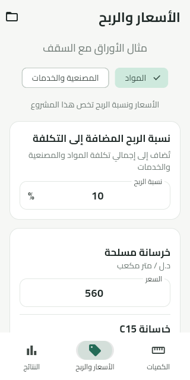
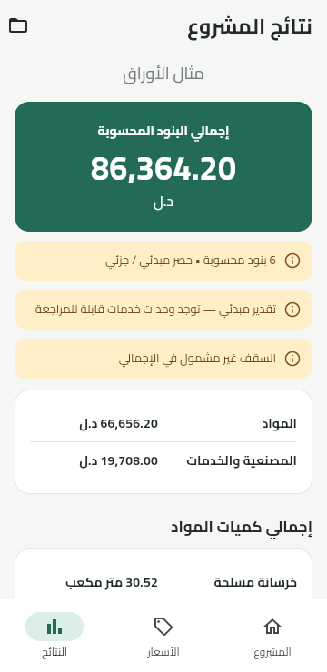

# Hasr · حصر المشروع

[](https://github.com/AlmotasmBazama/hasr-alqawaed/actions/workflows/flutter.yml)

An Arabic RTL Flutter application for project quantity takeoffs and cost estimates. Version 2 expands the original foundation calculator to seven work categories, independent local projects, editable models and multi-page Arabic PDF reports.

**[Live demo](https://hasr-alqawaed-preview.web.app)** · **[العربية](README.ar.md)** · **[Sample report](docs/sample-report.pdf)**

The **[original foundation-only app (v1)](https://hasr-alqawaed-v1.web.app/)** remains available independently. The **[latest project estimator](https://hasr-alqawaed-preview.web.app/)** keeps its existing address. Each origin has separate local storage.

<table><tr><td></td><td></td><td></td></tr></table>

## Features

- Three screens: project quantities, project prices and results.
- Foundations, below-tie masonry, tie beams, lean slabs, columns, above-tie masonry, and a roof awaiting a user-defined model.
- Dynamic material/service rows, editable coefficients and divisors, and labelled pricing units.
- Independent project prices and model snapshots, with explicit per-row price overrides.
- Material aggregation by identity, specification and unit. Costs sum actual line costs; labor quantities retain their work category and pricing unit.
- Arabic/Persian digits and Arabic decimal separator. Incomplete inputs produce incomplete work items and never reuse the previous calculation for a report.
- Local persistence, one-time migration with a raw backup, and serialized writes.
- One immutable result shared by screen and PDF; embedded Cairo fonts, A4 pages and repeated table headers.
- Android system sharing and browser file sharing with a PDF download fallback.

## Models and calculation

Each row is `work quantity × coefficient ÷ divisor × unit price`. Rounding occurs only for display. These are supplied estimation coefficients; no extra waste allowances or reinforcement assumptions are added.

| Work | Input | Material coefficients per input unit | Services per input unit |
| --- | --- | --- | --- |
| Foundations | count | RC 0.75 m³; steel 14: 3.5 / 6.5 quintals; steel 8: 1 / 20 quintals | carpenter, steel worker, casting: 1 foundation each |
| Below-tie masonry | linear metre | blocks 10; cement 0.30 bags; sand 0.05 m³ | water, mason, stocking: 1 linear metre each |
| Tie beam | linear metre | RC 0.08 m³; steel 14: 0.55 / 6.5; steel 8: 0.60 / 20 quintals | carpenter, steel worker, casting: 1 linear metre each |
| Lean slab | square metre | C15 0.10 m³ | water, carpenter, mixer: 1 m² each |
| Columns | count | RC 0.256 m³; steel 14: 3 / 6.5; steel 8: 2 / 20 quintals | carpenter, steel worker, casting: 1 column each |
| Above-tie masonry | linear metre | blocks 37.5; cement 1 bag; sand 0.07 m³ | water 1 linear metre; mason 3.2 m²; stocking 1 linear metre |
| Roof | user-defined | no supplied coefficients | no supplied coefficients |

Foundation dimensions are descriptive: 1.20 × 1.20 × 0.50 does not replace the 0.75 m³ coefficient. Column counts are independent. Lean slab input is area, its concrete output is volume, and it has no default steel.

Initial material prices (LYD): RC 560/m³, C15 500/m³, steel 14 520/quintal, steel 8 600/quintal, block 20 1.80/block, delivered cement 42/bag, sand 70/m³. All prices belong to the current project.

Masonry water and lean slab water/mixer use execution length/area as a **reviewable** pricing basis. They are not water volumes or vehicle/equipment counts. An undefined roof has a null cost, remains visibly pending in scope, and is excluded from calculated totals.

## Reproducible example

Create the separate **مثال الأوراق** project from the picker. Quantities are 20, 130, 130, 200, 20 and 130. These values are never injected into migrated projects.

| Work | Cost (LYD) |
| --- | ---: |
| Foundations | 17,800.00 |
| Below-tie masonry | 6,383.00 |
| Tie beam | 19,084.00 |
| Lean slab | 11,900.00 |
| Columns | 11,567.20 |
| Above-tie masonry | 19,630.00 |
| Calculated total, excluding roof | **86,364.20** |

Materials cost **66,656.20**, services/labor **19,708.00**. Aggregates: RC 30.52 m³; C15 20 m³; steel 14 31 quintals; steel 8 6.90 quintals; blocks 6,175; cement 169 bags; sand 15.60 m³. Changing shared cement price from 42 to 40 affects both masonry works and reduces total by 338 to **86,026.20**.

## Data and architecture

| Directory | Responsibility |
| --- | --- |
| lib/project/ | Projects/models, catalogue, engine, controller and versioned repository |
| lib/domain/, lib/data/ | Original v1 data/calculator retained for migration and regression tests |
| lib/services/ | Project PDF and conditional browser export |
| lib/ui/ | Project shell, details, model editor, export dialog and theme |
| test/, integration_test/ | Domain, migration, persistence, UI, PDF and native tests |

SharedPreferencesAsync storage belongs to each device/browser origin. No account, database or synchronization is required. Keep the same web origin and Android ID `ly.hasr.hasr_alqawaed` to retain data.

Migration checks v2 first, backs up original v1 JSON, creates **مشروعي السابق**, saves v2, then records success. The original key remains. Custom foundation IDs, coefficients, selection, count and six old prices survive; new categories start excluded. Reopening does not duplicate projects. Failed reads/migration writes do not silently overwrite data. Writes are serialized, and unfinished editor text remains separate from valid stored values.

## Build and validation

Toolchain: **Flutter 3.41.9 / Dart 3.11.5**, Android minimum SDK 24.

```sh
flutter pub get
dart format lib test integration_test
flutter analyze
flutter test
flutter test test/project_report_test.dart --dart-define=GENERATE_SAMPLE=true
flutter build web --release --no-web-resources-cdn
flutter build apk --debug
flutter build apk --release
```

APK: `build/app/outputs/flutter-apk/app-debug.apk` or the optimized `app-release.apk`. Both currently use the development signing key for testing; preserve that identity for updates. Native test: `flutter test integration_test/app_test.dart -d <device-id>`; rebuild the normal APK afterwards. Windows release AOT tools may resolve an ASCII junction back to an Arabic path; use an actual ASCII source directory for that build.

68 automated tests pass, covering example totals/quantities, price and coefficient changes, project independence, overrides, invalid input, missing roof, migration, save failures and PDF snapshots. A native Android integration test verifies migration, price edits, reopening independent projects and PDF generation. UI checks cover 320px screens, keyboard insets and 1.8× text. Browser checks use `scripts/check_web.cjs` (Playwright), PDF checks use `scripts/inspect_web_pdf.py` (PyMuPDF). The example PDF is eight visually reviewed A4 pages. The retained v1 UI harness is separate from the production v2 entry point.

Physical-phone browser sharing and iOS builds are not verified. iOS needs macOS/Xcode. GitHub Actions runs format checks, analysis, tests and web builds.

## Hosting

The existing Firebase Hosting site is defined in `.firebaserc` and `firebase.json`. No Firebase SDK is required. For a separate deployment, configure your own project/site IDs.

The original app is preserved on the separate `hasr-alqawaed-v1` live site, cloned from archived Hosting version `25763ed3cfbaec6b`. The tracked deployment configuration targets only the latest app, `hasr-alqawaed-preview`; do not deploy the current project build over the original site.

```sh
flutter build web --release --no-web-resources-cdn
firebase deploy --only hosting --project <your-project-id> --config firebase.json
node scripts/serve_web.mjs
```

Preview serves only build/web on 127.0.0.1; Windows start/stop helpers are in scripts/. Never publish the repository root.

Cairo fonts, their [SIL Open Font License](assets/fonts/OFL.txt) and source information are bundled locally. Developed with AI-assisted implementation and automated/device/browser verification; documentation records behavior and verification limits.
